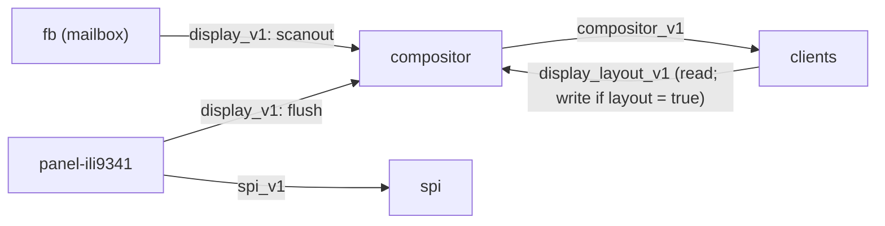

# Multi-display design

Status: **paused** (2026-11-25). Slices 1–5 are built and board-verified (see
Slices). The layout EventCount and slice 6 (hotplug) wait for D3 and D5,
which are written up under "Paused: D3 and D5". Decisions
M1–M10 and the three follow-ups were
answered by the maintainer on 2026-11-24, as were D1, D2, D4, D6 and D7; all are
recorded here. D3 and D5 (how EventCounts reach the compositor and its clients)
are still open and will be discussed in more detail later.

## Scope

Today the compositor (`userspace/gui/compositor`) drives one output:
- It configures the mailbox framebuffer at 1024×768×32 through `fb_v1`.
- It maps the framebuffer's Frames write-combining.
- It composes damaged rectangles into one cacheable back buffer and copies them
  out (`frame.rs`, `compositor-core::blit::present`).
- The router clamps the pointer to that one screen.

Step 5 of the SPI panel work added a second output, the MSP2202 ILI9341 panel
(`drivers/panel-ili9341`). It has 240×320 pixels in big-endian RGB565, and it
holds no memory the CPU can scan out from: every change is pushed over SPI.
A full frame takes 47–120 ms at 31.25 MHz.

This design lets the compositor drive any number of outputs of either kind:
- with their physical arrangement, orientation, size and DPI;
- with a runtime API to arrange them;
- with outputs that can come and go.

Out of scope:
- scaling (M6), and persisting the layout (M4);
- DMA for SPI pixels (an spi server item);
- DSI.

## Decisions

| | Decision |
|---|---|
| M1 | A new `display_v1`, exported by every output. The fb driver exports it next to `fb_v1`, and the panel driver exports it too. The compositor imports `display_v1` from every provider. |
| M2 | The compositor converts its 32 bpp pixels to each output's format while presenting. Drivers only scan out or flush. |
| M3 | One desktop coordinate space. Each output is a viewport into it, with its own back buffer. A window spanning two outputs is composed into both. |
| M4 | Arrangement comes from a runtime API, `display_layout_v1`, obtained through `compositor_v1`. Any client may read it. Writes need `layout = true` on the client's manifest entry. Not persisted: every boot starts from a row of outputs in discovery order, unrotated. |
| M5 | Rotation is done by the output where it can (`describe` lists the rotations the output does itself), and by the compositor otherwise. |
| M6 | Physical size and DPI are reported. Everything renders 1:1. |
| M7 | The pointer roams the union of the outputs and stops where no output continues. Focus rules don't change. |
| M8 | Per-output pacing. A flush output gets new damage only once its previous flush has finished, so a scanout output never waits for a flush output. |
| M9 | Hotplug is designed in now. A provider advances an EventCount and bumps a generation number. The compositor rereads, then advances its layout EventCount, and layout readers reread. |
| M10 | A new window opens on the output under the pointer. A window left on a removed output moves to the output under the pointer, or to the first output, keeping its size, clamped to fit. The pointer moves back onto the union. |
| D1 | (a) A new provider form, `uses display_v1 via every { ... }`: one import for each exporting instance, up to a declared maximum. |
| D2 | `display_v1` has `get_mode`/`set_mode`. An output starts in a default mode of its own. For HDMI this needs the EDID block, because the monitor may report a preferred resolution. |
| D4 | First answer: the compositor lends its own Frames to a flush output, because it is the only authority over graphics memory. Revised the same day, after the `LENT`-mapping check: `display_v1` declares a `data` area that Kickstart shares between the compositor and each output, so the compositor writes pixels there and `flush` sends from it. A scanout output's memory is still the hardware's (the firmware's framebuffer). |
| D6 | The desktop origin is renormalized after each change, to the output with the lowest x, then lowest y. Clients see window-relative coordinates, so it doesn't affect them. |
| D7 | `MAX_OUTPUTS` = 2 for now: only two displays are being tested. |

## Shape



Each output is one `display_v1` instance. The compositor keeps an **output
table** with a fixed capacity, `MAX_OUTPUTS` = 2 (D7). Each entry holds:
- the provider's description and generation;
- its viewport: desktop position, size after rotation, and rotation;
- whether the output or the compositor applies the rotation;
- a cacheable back buffer at 32 bpp, sized to the viewport;
- the output's pixel memory: the provider's frames mapped write-combining for a
  scanout output, or, for a flush output, the `display_v1` data area shared
  with the provider (D4);
- its damage set, and for a flush output whether a flush is in flight.

## `display_v1` (drivers)

A sketch, in the style of `fb_v1.if`:

```
## One display output. The compositor holds it: it reads the description,
## takes the frames the output shows, writes its pixels there in the output's
## format, and (for a flush output) says which rectangle to send. Prototype:
## edited in place.
local interface display_v1
{
    placement 1;

    ## How pixels sit in the output's frames.
    enum format {
        xrgb8888,     # 32-bit, blue in the lowest byte (the mailbox's bgr order)
        xbgr8888,     # 32-bit, red in the lowest byte (the mailbox's rgb order)
        rgb565_be,    # 16-bit, high byte first (the ILI9341's 65K format)
    }

    ## Rotation as a set (bit n: n quarter turns clockwise), and one turn.
    enum rotation { r0, r90, r180, r270 }

    ## The pixels a flush output sends (D4): the compositor writes them, the
    ## output reads them. 240x320 RGB565 (153600 bytes) in 38 pages.
    data 155648;

    exception not_present { card32 generation; }  # the output is gone
    exception unsupported {}        # a rotation the output cannot do itself
    exception install_failed { card32 installed; }
    exception already_handed_out {}
    exception bad_rectangle {}

    exception no_mode {}            # no such mode index, or the output refused it

    ## What the output is now. `scanout` is true for an output that shows
    ## its own memory by itself (no `flush`). `width_mm`/`height_mm` are 0 when
    ## unknown. `rotations` is the set of rotations `rotate` accepts.
    ## `generation` changes whenever any of this changes or the output goes
    ## away (then `not_present` carries it). Five words: the most a call
    ## returns (Meddle's `RESULT_WORDS`).
    describe()
        returns (card32 generation, boolean scanout,
                 card32 width_mm, card32 height_mm, card32 rotations)
        raises (not_present);

    ## The output's modes (D2): `count` of them, index 0 its preferred one
    ## (the EDID's preferred timing for HDMI, the panel's only mode).
    modes() returns (card32 count);
    mode(card32 index)
        returns (card32 width, card32 height, format format, card32 refresh_mhz)
        raises (no_mode);

    ## The current mode and its pitch in bytes. An output starts in a default
    ## of its own choosing (its preferred mode where it knows one).
    get_mode()
        returns (card32 width, card32 height, card32 pitch, format format)
        raises (not_present);

    ## Switch to mode `index`; advances the generation. A scanout output's
    ## memory changes with it: the compositor takes the new `frames`.
    set_mode(card32 index)
        returns (card32 width, card32 height, card32 pitch, format format)
        raises (not_present, no_mode);

    ## Scanout outputs: install the Frames of the output's own memory into the
    ## lent table, at consecutive slots from `first_slot`; once per generation.
    ## Also returns where the first pixel is inside the first Frame, in bytes.
    frames(card32 first_slot) lends (key_table into)
        returns (card32 installed, card32 offset)
        raises (not_present, already_handed_out, install_failed);

    ## Turn the output's own scan direction; returns the new width and height
    ## (the pitch of the frames stays). Advances the generation.
    rotate(rotation rotation)
        returns (card32 width, card32 height)
        raises (not_present, unsupported);

    ## Send the rectangle of `screen` (the whole screen in the caller's data
    ## area, in the current mode's format and pitch) to the glass (a flush
    ## output only; a scanout output returns at once). Returns when it is
    ## sent. Meddle requires a function to reference a declared data area,
    ## and the reference is two of the six argument words.
    flush(card32 x, card32 y, card32 width, card32 height, octet& screen)
        raises (not_present, bad_rectangle);
}
```

The interface as implemented is `drivers/display/interfaces/display_v1.if`. It
adds `badged;`, plus `failed` for bus errors, and the exact field order and
exceptions there take precedence over this sketch.

- **The panel driver** owns no pixel memory. Its pixels live in the
  `display_v1` data area Kickstart shares between it and the compositor (D4).
  - `modes` has one entry: 240×320 `rgb565_be`. `frames` raises `unsupported`.
  - `flush` sets the address window (CASET/RASET), reads the rectangle's rows
    from the data area, and sends them through `spi_v1` in 4 KiB chunks, as
    `draw_bars` does today, then returns.
- **Why a data area (D4, revised 2026-11-24).** The first plan was for the
  compositor to lend a Frame on every `flush`. A Frame lent with `CallWithKey`
  is a `LENT` entry: the callee can invoke it, so it can Map it, but it can
  never CopyDerive or Move it. However, Return only nulls the borrowed entry
  (`release_placed`), and deleting a mapped Frame leaves its mapping in place,
  so a mapping the callee forgot would outlive the call. The maintainer chose
  the shared data area instead: no lending and no kernel change. The
  LENT-mapping gap remains a known gap in the contract.
  - Meddle's `MAX_DATA_BYTES` goes from 64 KiB to 256 KiB. Kickstart lays every
    pair's area out with one cursor over a single 2 MiB data window
    (`data_cursor`, `DATA_WINDOW_BYTES` in `kernel/kickstart/src/drivers.rs`),
    so the panel's area comes out of the whole image's 2 MiB. Before the
    compositor image gains the panel (slice 4), measure its current total and
    raise the window if it doesn't fit.
  - The area is per interface, so a scanout exporter (fb) gets one too, unused.
    That is 152 KiB per pair, and the compositor has two pairs at most (D7).
  - `rotations` is all four. `rotate` sets MADCTL (36h, ILI9341 datasheet
    §8.2.29) through mipidsi's orientation, and swaps width and height for 90 and 270.
  - `scanout` is false.
- **The fb driver** exports `display_v1` next to `fb_v1`, over the same
  framebuffer.
  - `scanout` is true, `rotations` is only `r0`, and `flush` returns at once.
  - Modes come from the EDID (D2), read through the mailbox's `Get EDID block`
    tag (0x00030020, firmware wiki "Mailbox property interface"). The parser
    is `drivers/fb/src/edid.rs`, after Wikipedia's summary of VESA E-EDID 1.4,
    since the standard itself isn't public. It lists the progressive detailed
    timings (the first is the preferred one), then the standard timings, each
    size once.
    - The established timings aren't read: the source doesn't give their table.
    - The image size comes from the preferred timing's millimetres, else the
      screen's centimetres. A timing size of exactly 255×255 mm counts as "no
      size" (maintainer decision, 2026-11-25): the board's 1024×600 panel,
      about 165×95 mm, says 255×255 mm there and 18×13 cm in its screen size
      bytes.
    - Without a valid EDID there is one mode, 1024×768, with 0 mm. QEMU answers
      the tag with a block that isn't valid, so display-test runs on this
      fallback.
  - At start, the fb driver configures the first mode the firmware accepts.
    `set_mode` reconfigures the framebuffer only while its memory has not been
    handed out; after that it raises `already_handed_out`, because a new mode
    would need memory the holder's Frames don't cover. Giving the memory back
    (revoking the old Frames) would lift this, and is out of scope here.
  - Only the framebuffer's size changes. The HDMI signal's timing stays
    whatever the firmware set it to (config.txt).
  - `fb_v1` remains, and the compositor still calls `fb_v1.configure(1024, 768,
    32)` until slice 4 moves it to `display_v1`.
  - The fb driver's calls wait until it has configured its first mode at
    start: a client's call can arrive before that (display-test hit this
    race).
- **Generation and EventCount.** A provider advances an EventCount whenever the
  generation changes. How that EventCount reaches the compositor is D3. Neither
  provider changes on its own today: there's no HDMI plug source and the panel
  is fixed. The path exists so that one can be added later without changing the
  interface.

## Compositor changes

- **Discovery.** At start, the compositor calls `describe` and `get_mode` on every
  `display_v1` import (`uses display_v1 via every max 2`, D1) and fills the
  output table. An output is left out when `describe` raises `not_present`,
  when its memory cannot be mapped, or when its mode does not fit its data
  area; at least one output must remain. Each output keeps the mode it chose
  for itself (D2): the fb component's EDID-preferred mode, or 1024×768 without
  an EDID. The default layout places outputs left to right at y = 0, in import
  order, unrotated. The first output's top-left corner is the desktop origin.
  Before the layout is made, the outputs are ordered scanout first, then by
  pixel area, largest first, with import order breaking ties. So the biggest
  scanout output is the primary one (maintainer, 2026-11-25). On the first
  board run, Kickstart loaded the panel before fb, which made the panel
  output 0.
- **Canvas format.** Back buffers and surfaces use the format of the first
  32-bit output, so that output shows them by copying. Clients learn it as
  `compositor_v1.pixel_order`, as before. With no 32-bit output it is
  `xrgb8888`.
- **Scanout memory.** `libframebuffer` maps a scanout output's Frames
  through `display_v1.frames` instead of `fb_v1`. `frames` also returns the
  byte offset of the first pixel inside the first Frame, because `display_v1`
  has no `address`. Kickstart gives the map window to `display_v1` importers
  too, and the window has 6 spans, so a 1920×1200 framebuffer fits at any
  alignment.
- **Damage.** Each output keeps its own damage set, in desktop coordinates
  clipped to its viewport. Damaging a desktop rectangle adds it to every
  output that shows part of it.
- **Drawing.** Each output's back buffer is drawn by exactly one Thread. That
  Thread composes the damage in viewport coordinates, with the windows bottom
  to top and the cursor last, then converts the finished rectangles (M2). The
  code is in `compositor-core::blit`: `compose` and `present`, which calls
  `convert_row` once per row.
  - `xrgb8888` is a copy, and `xbgr8888` a swap.
  - `rgb565_be` packs `r>>3, g>>2, b>>3` and stores the high byte first.

  The loops work a row at a time on slices, and blending has no branch on
  alpha, only a final select, so the compiler vectorizes them. The compositor
  is an FP/SIMD component, built for the hard-float target at opt-level 3. The
  linked binary uses NEON for the blend's divide by 255 and for the
  conversions.
- **Frame Thread (scanout outputs).** It draws every scanout output that has
  damage, then waits a frame time. It writes straight into the
  write-combining memory.
- **Presenter Thread per flush output (M8).** There is one presenter for each
  output index (`presenter_0`, `presenter_1`); a presenter whose output is not
  a flush output parks. A presenter takes its output's damage under a turn,
  composes and converts it into the shared data area without the turn, then
  calls `flush` for each rectangle and waits a frame time. New damage collects
  in the output's set while a flush is in flight, so the next batch picks it
  up. Because `flush` is a synchronous call, only the presenter blocks, for up
  to about 120 ms; the frame Thread and the input Thread never wait for SPI.
  The presenter composes for itself, instead of converting from a back buffer
  that the frame Thread draws, so that each back buffer has one writer.
  A rectangle whose `flush` fails goes back into the output's damage and is
  sent with the next batch. The presenter counts failures, and the input
  Thread traces the count each time it reaches a power of two, together with
  the last exception.
- **Moving windows (interim).** The compositor does not move windows itself
  yet. A client moves its own window with an Alt + left drag, using
  `compositor_core::drag::Mover`. The client feeds the Mover its window's
  events, and the Mover answers with places to `move_window` to. It starts
  from the new `compositor_v1.position`. Supporting changes:
  - The router now sends a window that gains the focus a `Key` down for every
    key already held, so a click made with Alt held starts a move.
  - draw-demo and the shell use the Mover.
  - window-events-test feeds every record to a Mover and checks that a drag
    without Alt never moves its windows.
  - Wood (a submodule) is not wired up yet.

  The maintainer's words, 2026-11-25: "we will refactor this later into a
  protocol".
- **Rotation (M5).** Not in slice 4: nothing sets a rotation before
  `display_layout_v1` (slice 5). Setting a rotation calls the provider's `rotate` when that
  rotation is in `rotations`; the viewport then simply takes the returned size.
  Otherwise the compositor rotates while converting, and the viewport takes
  width and height swapped.
- **Pointer (M7).** The router's single screen rectangle becomes the list of
  viewports. A motion step is applied on each axis, then the pointer is clamped
  to the nearest point inside some viewport, so it crosses edges where outputs
  touch and stops where they don't. The cursor sprite is drawn into every
  viewport it overlaps.
- **New windows (M10).** `create_window` places the window inside the output
  under the pointer, using today's placement rule within that viewport. The
  window is moved back left and up as far as needed to fit, but never past
  the viewport's top-left corner (`Layout::place`).
- **Removal (M10).** When `describe` starts raising `not_present`:
  - the viewport goes away;
  - each window entirely inside it moves to the pointer's output, or to the
    first output, clamped to fit and keeping its size;
  - the pointer is clamped back onto the union;
  - everything is damaged.

  A window that was only partly on the removed output stays where it is.
- **Arrival.** An output that becomes present is placed to the right of the
  rightmost viewport, unrotated.

Host tests in `compositor-core` (no hardware; the `drawing` and `layout`
modules of its test file):
- format conversion, including RGB565 truncation and byte order, and the
  output pitch;
- a row of blends against the per-pixel blend;
- clipping damage across two viewports;
- pointer clamping over L-shaped and gapped layouts, and the router crossing
  outputs;
- placing new windows and moving windows off a removed output
  (`Layout::rehome`; used once hotplug lands);
- renormalizing the origin (`Layout::renormalize`; used once the layout can
  change).

The presenter's damage merge is the existing `Damage` set.

## `display_layout_v1` (clients)

It is obtained through `compositor_v1`, in the same way `usb_hcd_v1.open_pipe`
installs `pipe_v1` keys:

```
## compositor_v1, new:
    ## Install the keys of display_layout_v1, one per function in declaration
    ## order, in the lent table from `first_slot`, badged with the caller's
    ## badge. A caller whose manifest entry says `layout = true` may set; any
    ## other gets not_permitted from the set functions.
    display_layout(card32 first_slot) lends (key_table into)
        installs (display_layout_v1)
        raises (not_permitted, install_failed);
```

```
local interface display_layout_v1
{
    badged;
    enum rotation { r0, r90, r180, r270 }
    exception no_output {}
    exception not_permitted {}
    exception overlaps {}           # the new viewport would overlap another

    ## The layout's generation: it changes whenever an output comes, goes,
    ## moves or turns.
    generation() returns (card32 generation);

    ## How many outputs there are, and the one at `index` (0..count):
    ## its id (stable while it is present), desktop rectangle, rotation,
    ## physical size (0 when unknown) and so its DPI.
    count() returns (card32 outputs);
    output(card32 index)
        returns (card32 id, int32 x, int32 y, card32 width, card32 height,
                 rotation rotation, card32 width_mm, card32 height_mm)
        raises (no_output);

    ## Arrangement (layout = true only).
    set_position(card32 id, int32 x, int32 y)
        raises (no_output, not_permitted, overlaps);
    set_rotation(card32 id, rotation rotation)
        raises (no_output, not_permitted);

    ## Which output the window is mostly on.
    window_output(card32 window) returns (card32 id) raises (no_output);
}
```

- **As built (slice 5).** The interface lives at
  `userspace/gui/compositor/interfaces/display_layout_v1.if`. It differs from
  the sketch above in these ways:
  - A result holds at most 5 words, so `output` returns the id and the
    viewport, and a separate `output_details` returns the rotation and the
    millimetres.
  - `set_rotation` also raises `overlaps`, when the turned viewport would
    cover another one, and `failed`, when the output's `rotate` failed.
  - `display_layout` writes the installed wire keys to the data area, as
    `open_pipe` does.
  - The interface has no data area. Meddle used to require an installed
    interface to declare its installer's area; it now allows one with no area
    at all, because its calls reference nothing.
  - Ids are the output's `display_v1` import instance.
- **The write gate.** Kickstart badges `compositor_v1` keys with the base of the
  client's shared area, which is page-aligned. It sets bit 0 of that badge
  (`libdevice_driver::LAYOUT_BADGE`) for a client whose manifest entry has
  `layout = true`:
  - in image-build, a new field `layout` on `[[component]]` and `[[driver]]`;
  - in libimage, `DriverImage.layout`;
  - in Kickstart, `badge | LAYOUT_BADGE` for that client's `compositor_v1`
    imports only.

  `DriverInit::area_for_badge` ignores the bit, so every exporter still finds
  the client's area. The `display_layout_v1` keys the compositor installs
  carry the same badge, so the set functions check bit 0. No new kernel kind
  or operation is needed (minimal kernel API).
- **Rotation.** `set_rotation` asks the output to turn itself when
  `describe` listed that turn (the panel can do all four). Otherwise the
  output stays upright and the compositor turns the pixels while presenting
  (`compositor_core::blit::present_turned`, the framebuffer). The output entry
  keeps the following:
  - the output's upright size;
  - the turn the output applies itself;
  - the turn the compositor applies in software;
  - the size of the output's memory as it is turned now.

  A presenter flushes the rectangle of the output's own memory that a
  viewport rectangle maps to (`layout::native_rect`). The turn call to the
  output holds the compositor's turn while it runs: drawing waits for the few
  commands a turn takes, and nothing draws for the old orientation in the
  meantime.
- **Clients.** The shell's prompt has `layout`, `layout turn <id>
  <0|90|180|270>` and `layout move <id> <x> <y>`, and the production image
  gives the shell `layout = true`. layout-test (QEMU) loads one client twice:
  - the arranger turns and moves the framebuffer, through the software turn;
  - the reader is refused every change.
- **Layout EventCount.** When the compositor changes the layout, it advances an
  EventCount. Readers wait on it, then reread `generation` and the list. How a
  client gets an await-only key to it is D5.
- **Validation.** A `set_position` whose viewport would overlap another viewport
  raises `overlaps`. Gaps are allowed: the pointer simply doesn't cross them.
- **Renormalization (D6).** After each change, the output at the lowest x, then
  the lowest y, becomes the origin, so every desktop coordinate shifts by the
  same offset. Viewports, window positions and the pointer shift together, so
  nothing moves on the glass. Clients see window-relative coordinates and
  notice nothing. Only `move_window` arguments and `output()` rectangles are
  desktop coordinates, and a layout reader sees the shift through `generation`.

## Kickstart and Meddle

- Image-build: a manifest entry's `exports = ["dir", ...]` (slice 1) names
  further directories whose interfaces the component exports. Every output
  exports `display_v1`, so `display_v1.if` lives in `drivers/display/interfaces`
  instead of in one driver's own directory. Those directories are also searched
  for imports.
- Image-build: a `layout = true` manifest field (above).
- Meddle and Kickstart: `via every` (D1, done in slice 3).
  - The syntax is `uses X via every max N { ... }`, with `every` and `max`
    contextual like `device` and `parent`. The maximum is written out, because
    Meddle can't see the client's constants; the compositor will write
    `every max 2`, matching `MAX_OUTPUTS` (D7).
  - The checker requires `every` to be the use's only provider (there is
    nothing to fall back to) and `N` to be 1 to `MAX_EVERY_INSTANCES` (4).
  - It is `ProviderSummary::Every(N)` in the summary and `Provider::Every(N)`
    in libimage.
  - Kickstart links each function of the import once to each loaded instance
    that exports the interface (the client itself excluded), in load order, up
    to N. Each pair gets its own data area and placement window. If there are
    more exporters than N, or none, it prints one line saying how many it
    linked.
  - The `ImportRecord` layout doesn't change. A function's *n*-th record
    belongs to instance *n*, because every function is linked to the same
    exporters in the same order. The generated client has
    `Bindings::instances(imports)` and `Bindings::from_imports_nth(imports, n)`,
    and `from_imports` is instance 0. The counting is
    `meddle_runtime::{nth_instance, instance_count}`, host-tested in
    `libs/meddle-runtime/tests/words.rs`.
  - Telling the instances apart (a node path or component name per instance)
    isn't needed yet: the compositor tells outputs apart by asking each one to
    `describe` itself.
  - every-test (QEMU) checks it: three programs export `echo_v1`, and a client
    importing it `via every max 2` gets the first two, each with its own area
    and its own call count. The third is left unlinked.
- Nothing else changes in Kickstart.

## Slices

1. **`display_v1` on the panel.**
   - Raise Meddle's `MAX_DATA_BYTES` to 256 KiB.
   - Add the interface, with `flush` from the data area, `rotate` and the
     single mode.
   - Extend panel-test with a small client that writes RGB565 into the data
     area and flushes rectangles, as the board check.
   - Add host tests for the rectangle-to-window commands.
2. **`display_v1` on the fb driver**, next to `fb_v1`:
   - EDID parsing in a host-tested library, with the format cited;
   - `modes`, `get_mode`/`set_mode`, the self-configured preferred mode, and
     `frames`.
3. **`via every`** in Meddle, image-build and Kickstart, with host tests and a
   QEMU test kernel that has two exporters of one interface.
4. **Multi-output compositor core**:
   - in `compositor-core`: conversion, viewports, pointer union, placement and
     renormalization, with host tests;
   - the output table, the frame Thread's per-output composition and the
     presenter Thread.

   QEMU covers the scanout output; the board covers HDMI and the panel together.
5. **`display_layout_v1`**, the `compositor_v1.display_layout` function, and the
   manifest flag and badge bit. A small `layout` test client arranges the
   outputs and reads them back. The layout EventCount waits for D5. Built on
   2026-11-25: layout-test passes under QEMU, and the shell's `layout`
   commands are for the board.
6. **Hotplug plumbing**: provider EventCounts and the generation path, plus the
   removal and arrival policy (after D3), tested with a fake provider that
   comes and goes (`not_present`).

## Paused: D3 and D5

Work stopped here on 2026-11-25 by the maintainer's choice, after slices 1–5
were built and board-verified. It resumes by discussing D3 and D5 in detail;
both are still open, and nothing below is decided.

What waits on them:
- slice 6, hotplug:
  - providers telling the compositor that an output changed (D3);
  - the arrival and removal policy (M9, M10). Its core is already built and
    host-tested (`Layout::rehome`, `Layout::renormalize`,
    `State::apply_layout`), but nothing triggers it yet;
- the layout EventCount, which tells layout readers that the arrangement
  changed (D5).

Nothing in use needs them today:
- No output changes by itself. The mailbox framebuffer has no hotplug
  source: the firmware does not report HDMI plug events, so fb would have to
  poll the firmware for them. The panel is fixed.
- The only layout client, the shell's `layout` command, reads on demand.

### D3: how a provider's change reaches the compositor

When an output's presence or mode changes, its provider bumps the generation
that `describe` returns. That much is settled (M9: EventCount + generation).
The open part is how the compositor learns that it should call `describe`
again.

- **(a) A channel on `display_v1`.** Kickstart already gives each pair of an
  interface that declares `channel N;` an io-channel, with an EventCount the
  exporter advances and the client awaits. `input_v1` reaches the compositor
  this way.
  - For: no new mechanism. The channel could also carry a change record.
  - Against:
    - a control page per pair (plus data pages if records travel) out of
      the 2 MiB data window that all pairs share;
    - the compositor would have to wait on several EventCounts at once (one
      per output, plus input), which means a WaitSet or a Thread per output.
- **(b) The compositor polls `describe`** on a slow timer (say once a
  second), from the frame Thread or a Thread of its own.
  - For: nothing new in Kickstart, Meddle or the providers.
  - Against:
    - a wakeup and a call per output per period, even when nothing changes;
    - arrival or removal seen up to a period late.
- **(c) A `display_v1` call that installs an await-only key** to the
  provider's EventCount in the caller's table, the way `display_layout`
  installs Invocation keys.
  - For: one EventCount per output, which a WaitSet can watch; no data
    window cost.
  - Against: a new pattern. `Masters` installs Invocation keys only, so
    installing another kind of key (an EventCount with only the right to
    await) needs a helper of its own. D5 (a) would use the same helper.

Whichever is chosen, fb also needs its own source of change: polling the
firmware for the display's presence and EDID.

### D5: how layout readers learn of a change

The compositor bumps `display_layout_v1.generation` on every move or turn,
and will on every arrival and removal. The open part is how a reader such as
a panel, a settings tool or a client that keeps its windows on one output
knows that it should read the layout again.

- **(a) `display_layout` also installs an await-only key** to a compositor
  EventCount that is advanced on every change. It would go in the slot after
  the interface's keys.
  - For: readers wait without polling, and a WaitSet can combine it with
    their other EventCounts.
  - Against: the same new key-installing helper as D3 (c), and one more slot
    and wire key in `display_layout`'s answer.
- **(b) A `LayoutChanged` record on the client's input io-channel**, which
  every compositor client already holds and reads.
  - For: no new mechanism on the kernel side; one new record kind in
    `vesper-input-event`.
  - Against:
    - layout news mixes with window events;
    - a client that has no buffer posted loses the record. It would then
      see `Dropped`, and must compare `generation` when it resynchronises;
    - only clients with an event channel can learn of changes.
- **(c) Readers poll `generation`.**
  - For: nothing new.
  - Against: wakeups and calls for nothing, and changes seen late.

If D3 and D5 both pick "install an await-only key" ((c) and (a)), they share
one helper.
