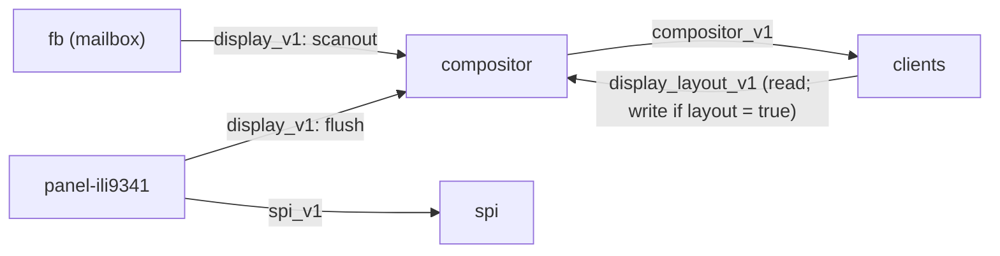

# Multi-display design

Status: design, no code yet. Decisions M1–M10 and the three follow-ups were
answered by the maintainer on 2026-11-24, as were D1, D2, D4, D6 and D7; all are
recorded here. D3 and D5 (how EventCounts reach the compositor and its clients)
are still open and will be discussed in more detail later.

## Scope

Today the compositor (`userspace/gui/compositor`) drives one output:
- It configures the mailbox framebuffer at 1024×768×32 through `fb_v1`.
- It maps the framebuffer's Frames write-combining.
- It composes damaged rectangles into one cacheable back buffer and copies them
  out (`frame.rs`, `compositor-core::blit::present`).
- The router clamps the pointer to that one screen.

Step 5 of the SPI panel work added a second output, the MSP2202 ILI9341 panel
(`drivers/panel-ili9341`). It has 240×320 pixels in big-endian RGB565, and it
holds no memory the CPU can scan out from: every change is pushed over SPI.
A full frame takes 47–120 ms at 31.25 MHz.

This design lets the compositor drive any number of outputs of either kind:
- with their physical arrangement, orientation, size and DPI;
- with a runtime API to arrange them;
- with outputs that can come and go.

Out of scope:
- scaling (M6), and persisting the layout (M4);
- DMA for SPI pixels (an spi server item);
- DSI.

## Decisions

| | Decision |
|---|---|
| M1 | A new `display_v1`, exported by every output. The fb driver exports it next to `fb_v1`, and the panel driver exports it too. The compositor imports `display_v1` from every provider. |
| M2 | The compositor converts its 32 bpp pixels to each output's format while presenting. Drivers only scan out or flush. |
| M3 | One desktop coordinate space. Each output is a viewport into it, with its own back buffer. A window spanning two outputs is composed into both. |
| M4 | Arrangement comes from a runtime API, `display_layout_v1`, obtained through `compositor_v1`. Any client may read it. Writes need `layout = true` on the client's manifest entry. Not persisted: every boot starts from a row of outputs in discovery order, unrotated. |
| M5 | Rotation is done by the output where it can (`describe` lists the rotations the output does itself), and by the compositor otherwise. |
| M6 | Physical size and DPI are reported. Everything renders 1:1. |
| M7 | The pointer roams the union of the outputs and stops where no output continues. Focus rules don't change. |
| M8 | Per-output pacing. A flush output gets new damage only once its previous flush has finished, so a scanout output never waits for a flush output. |
| M9 | Hotplug is designed in now. A provider advances an EventCount and bumps a generation number. The compositor rereads, then advances its layout EventCount, and layout readers reread. |
| M10 | A new window opens on the output under the pointer. A window left on a removed output moves to the output under the pointer, or to the first output, keeping its size, clamped to fit. The pointer moves back onto the union. |
| D1 | (a) A new provider form, `uses display_v1 via every { ... }`: one import for each exporting instance, up to a declared maximum. |
| D2 | `display_v1` has `get_mode`/`set_mode`. An output starts in a default mode of its own. For HDMI this needs the EDID block, because the monitor may report a preferred resolution. |
| D4 | First answer: the compositor lends its own Frames to a flush output, because it is the only authority over graphics memory. Revised the same day, after the `LENT`-mapping check: `display_v1` declares a `data` area that Kickstart shares between the compositor and each output, so the compositor writes pixels there and `flush` sends from it. A scanout output's memory is still the hardware's (the firmware's framebuffer). |
| D6 | The desktop origin is renormalized after each change, to the output with the lowest x, then lowest y. Clients see window-relative coordinates, so it doesn't affect them. |
| D7 | `MAX_OUTPUTS` = 2 for now: only two displays are being tested. |

## Shape



Each output is one `display_v1` instance. The compositor keeps an **output
table** with a fixed capacity, `MAX_OUTPUTS` = 2 (D7). Each entry holds:
- the provider's description and generation;
- its viewport: desktop position, size after rotation, and rotation;
- whether the output or the compositor applies the rotation;
- a cacheable back buffer at 32 bpp, sized to the viewport;
- the output's pixel memory: the provider's frames mapped write-combining for a
  scanout output, or, for a flush output, the `display_v1` data area shared
  with the provider (D4);
- its damage set, and for a flush output whether a flush is in flight.

## `display_v1` (drivers)

A sketch, in the style of `fb_v1.if`:

```
## One display output. The compositor holds it: it reads the description,
## takes the frames the output shows, writes its pixels there in the output's
## format, and (for a flush output) says which rectangle to send. Prototype:
## edited in place.
local interface display_v1
{
    placement 1;

    ## How pixels sit in the output's frames.
    enum format {
        xrgb8888,     # 32-bit, blue in the lowest byte (the mailbox's bgr order)
        xbgr8888,     # 32-bit, red in the lowest byte (the mailbox's rgb order)
        rgb565_be,    # 16-bit, high byte first (the ILI9341's 65K format)
    }

    ## Rotation as a set (bit n: n quarter turns clockwise), and one turn.
    enum rotation { r0, r90, r180, r270 }

    ## The pixels a flush output sends (D4): the compositor writes them, the
    ## output reads them. 240x320 RGB565 (153600 bytes) in 38 pages.
    data 155648;

    exception not_present { card32 generation; }  # the output is gone
    exception unsupported {}        # a rotation the output cannot do itself
    exception install_failed { card32 installed; }
    exception already_handed_out {}
    exception bad_rectangle {}

    exception no_mode {}            # no such mode index, or the output refused it

    ## What the output is now. `scanout` is true for an output that shows
    ## its own memory by itself (no `flush`). `width_mm`/`height_mm` are 0 when
    ## unknown. `rotations` is the set of rotations `rotate` accepts.
    ## `generation` changes whenever any of this changes or the output goes
    ## away (then `not_present` carries it). Five words: the most a call
    ## returns (Meddle's `RESULT_WORDS`).
    describe()
        returns (card32 generation, boolean scanout,
                 card32 width_mm, card32 height_mm, card32 rotations)
        raises (not_present);

    ## The output's modes (D2): `count` of them, index 0 its preferred one
    ## (the EDID's preferred timing for HDMI, the panel's only mode).
    modes() returns (card32 count);
    mode(card32 index)
        returns (card32 width, card32 height, format format, card32 refresh_mhz)
        raises (no_mode);

    ## The current mode and its pitch in bytes. An output starts in a default
    ## of its own choosing (its preferred mode where it knows one).
    get_mode()
        returns (card32 width, card32 height, card32 pitch, format format)
        raises (not_present);

    ## Switch to mode `index`; advances the generation. A scanout output's
    ## memory changes with it: the compositor takes the new `frames`.
    set_mode(card32 index)
        returns (card32 width, card32 height, card32 pitch, format format)
        raises (not_present, no_mode);

    ## Scanout outputs: install the Frames of the output's own memory into the
    ## lent table, at consecutive slots from `first_slot`; once per generation.
    frames(card32 first_slot) lends (key_table into)
        returns (card32 installed)
        raises (not_present, already_handed_out, install_failed);

    ## Turn the output's own scan direction; returns the new width and height
    ## (the pitch of the frames stays). Advances the generation.
    rotate(rotation rotation)
        returns (card32 width, card32 height)
        raises (not_present, unsupported);

    ## Send the rectangle of `screen` (the whole screen in the caller's data
    ## area, in the current mode's format and pitch) to the glass (a flush
    ## output only; a scanout output returns at once). Returns when it is
    ## sent. Meddle requires a function to reference a declared data area,
    ## and the reference is two of the six argument words.
    flush(card32 x, card32 y, card32 width, card32 height, octet& screen)
        raises (not_present, bad_rectangle);
}
```

The interface as implemented is `drivers/display/interfaces/display_v1.if`. It
adds `badged;`, plus `failed` for bus errors, and the exact field order and
exceptions there take precedence over this sketch.

- **The panel driver** owns no pixel memory. Its pixels live in the
  `display_v1` data area Kickstart shares between it and the compositor (D4).
  - `modes` has one entry: 240×320 `rgb565_be`. `frames` raises `unsupported`.
  - `flush` sets the address window (CASET/RASET), reads the rectangle's rows
    from the data area, and sends them through `spi_v1` in 4 KiB chunks, as
    `draw_bars` does today, then returns.
- **Why a data area (D4, revised 2026-11-24).** The first plan was for the
  compositor to lend a Frame on every `flush`. A Frame lent with `CallWithKey`
  is a `LENT` entry: the callee can invoke it, so it can Map it, but it can
  never CopyDerive or Move it. However, Return only nulls the borrowed entry
  (`release_placed`), and deleting a mapped Frame leaves its mapping in place,
  so a mapping the callee forgot would outlive the call. The maintainer chose
  the shared data area instead: no lending and no kernel change. The
  LENT-mapping gap remains a known gap in the contract.
  - Meddle's `MAX_DATA_BYTES` goes from 64 KiB to 256 KiB. Kickstart lays every
    pair's area out with one cursor over a single 2 MiB data window
    (`data_cursor`, `DATA_WINDOW_BYTES` in `kernel/kickstart/src/drivers.rs`),
    so the panel's area comes out of the whole image's 2 MiB. Before the
    compositor image gains the panel (slice 4), measure its current total and
    raise the window if it doesn't fit.
  - The area is per interface, so a scanout exporter (fb) gets one too, unused.
    That is 152 KiB per pair, and the compositor has two pairs at most (D7).
  - `rotations` is all four. `rotate` sets MADCTL (36h, ILI9341 datasheet
    §8.2.29) through mipidsi's orientation, and swaps width and height for 90 and 270.
  - `scanout` is false.
- **The fb driver** exports `display_v1` next to `fb_v1`, over the same
  framebuffer.
  - `scanout` is true, `rotations` is only `r0`, and `flush` returns at once.
  - Modes come from the EDID (D2), read through the mailbox's EDID block tag
    (0x00030020): the preferred detailed timing first, then the other timings
    the firmware can set. The EDID's image size also gives `width_mm` and
    `height_mm`. Without an EDID, the list is one default mode, 1024×768, with
    0 mm.
  - At start, the fb driver configures its preferred mode itself, so the
    compositor no longer calls `fb_v1.configure`. `set_mode` reconfigures the
    framebuffer through the firmware, and the compositor takes the new `frames`.
  - A source for the EDID layout (VESA E-EDID, the detailed timing descriptor
    and its image size bytes) is cited before that code is written.
- **Generation and EventCount.** A provider advances an EventCount whenever the
  generation changes. How that EventCount reaches the compositor is D3. Neither
  provider changes on its own today: there's no HDMI plug source and the panel
  is fixed. The path exists so that one can be added later without changing the
  interface.

## Compositor changes

- **Discovery.** At start, the compositor calls `describe` and `get_mode` on every
  `display_v1` import (`via every`, D1) and fills the output table. Outputs
  whose `describe` raises `not_present` are skipped. The default layout places outputs left to right at y = 0, in import
  order, unrotated. The first output's top-left corner is the desktop origin.
- **Frame Thread (scanout outputs).** As today, one frame composes every damaged
  rectangle. Each desktop damage rectangle is clipped to each viewport. The
  intersection is composed into that output's back buffer, in viewport
  coordinates, with the windows bottom to top and the cursor last. It is then
  converted (M2) and, when the compositor rotates (M5), rotated into the
  write-combining frames. The conversion is a `PixelWrite` per format, in
  `compositor-core::blit`:
  - `xrgb8888` is a copy, and `xbgr8888` a swap.
  - `rgb565_be` packs `r>>3, g>>2, b>>3` and stores the high byte first.
- **Presenter Thread per flush output (M8).** A flush output's damage
  accumulates in its own set. Its presenter Thread waits until there is damage
  and no flush in flight. It then takes a turn to:
  - take the damage, merged into at most a few rectangles;
  - convert those rectangles from the back buffer into the provider's frames.

  It then drops the turn and calls `flush` for each rectangle. Because `flush` is
  a synchronous call, only the presenter blocks, for up to about 120 ms; the
  frame Thread and the input Thread never wait for SPI. A window that changes
  during a flush is caught by the next one. On the panel, the cost is some
  tearing within a 40–120 ms window.
- **Rotation (M5).** Setting a rotation calls the provider's `rotate` when that
  rotation is in `rotations`; the viewport then simply takes the returned size.
  Otherwise the compositor rotates while converting, and the viewport takes
  width and height swapped.
- **Pointer (M7).** The router's single screen rectangle becomes the list of
  viewports. A motion step is applied on each axis, then the pointer is clamped
  to the nearest point inside some viewport, so it crosses edges where outputs
  touch and stops where they don't. The cursor sprite is drawn into every
  viewport it overlaps.
- **New windows (M10).** `create_window` places the window inside the output
  under the pointer, using today's placement rule within that viewport.
- **Removal (M10).** When `describe` starts raising `not_present`:
  - the viewport goes away;
  - each window entirely inside it moves to the pointer's output, or to the
    first output, clamped to fit and keeping its size;
  - the pointer is clamped back onto the union;
  - everything is damaged.

  A window that was only partly on the removed output stays where it is.
- **Arrival.** An output that becomes present is placed to the right of the
  rightmost viewport, unrotated.

Host tests in `compositor-core` (no hardware):
- format conversion, including RGB565 rounding and byte order;
- clipping damage across two viewports;
- pointer clamping over L-shaped and gapped layouts;
- placing new windows and moving windows off a removed output;
- the presenter's damage merge.

## `display_layout_v1` (clients)

It is obtained through `compositor_v1`, in the same way `usb_hcd_v1.open_pipe`
installs `pipe_v1` keys:

```
## compositor_v1, new:
    ## Install the keys of display_layout_v1, one per function in declaration
    ## order, in the lent table from `first_slot`, badged with the caller's
    ## badge. A caller whose manifest entry says `layout = true` may set; any
    ## other gets not_permitted from the set functions.
    display_layout(card32 first_slot) lends (key_table into)
        installs (display_layout_v1)
        raises (not_permitted, install_failed);
```

```
local interface display_layout_v1
{
    badged;
    enum rotation { r0, r90, r180, r270 }
    exception no_output {}
    exception not_permitted {}
    exception overlaps {}           # the new viewport would overlap another

    ## The layout's generation: it changes whenever an output comes, goes,
    ## moves or turns.
    generation() returns (card32 generation);

    ## How many outputs there are, and the one at `index` (0..count):
    ## its id (stable while it is present), desktop rectangle, rotation,
    ## physical size (0 when unknown) and so its DPI.
    count() returns (card32 outputs);
    output(card32 index)
        returns (card32 id, int32 x, int32 y, card32 width, card32 height,
                 rotation rotation, card32 width_mm, card32 height_mm)
        raises (no_output);

    ## Arrangement (layout = true only).
    set_position(card32 id, int32 x, int32 y)
        raises (no_output, not_permitted, overlaps);
    set_rotation(card32 id, rotation rotation)
        raises (no_output, not_permitted);

    ## Which output the window is mostly on.
    window_output(card32 window) returns (card32 id) raises (no_output);
}
```

- **The write gate.** Kickstart badges `compositor_v1` keys with the base of the
  client's shared area, which is page-aligned. It would set bit 0 of that badge
  for a client whose manifest entry has `layout = true`:
  - in image-build, a new field `layout` on `[[component]]` and `[[driver]]`;
  - in libimage, `DriverImage.layout`;
  - in Kickstart, `badge | 1` for that client's `compositor_v1` imports only.

  The compositor masks the bit off to find the client's area, and the
  `display_layout_v1` keys it installs carry the same badge, so the set
  functions check bit 0. No new kernel kind or operation is needed (minimal
  kernel API).
- **Layout EventCount.** When the compositor changes the layout, it advances an
  EventCount. Readers wait on it, then reread `generation` and the list. How a
  client gets an await-only key to it is D5.
- **Validation.** A `set_position` whose viewport would overlap another viewport
  raises `overlaps`. Gaps are allowed: the pointer simply doesn't cross them.
- **Renormalization (D6).** After each change, the output at the lowest x, then
  the lowest y, becomes the origin, so every desktop coordinate shifts by the
  same offset. Viewports, window positions and the pointer shift together, so
  nothing moves on the glass. Clients see window-relative coordinates and
  notice nothing. Only `move_window` arguments and `output()` rectangles are
  desktop coordinates, and a layout reader sees the shift through `generation`.

## Kickstart and Meddle

- Image-build: a manifest entry's `exports = ["dir", ...]` (slice 1) names
  further directories whose interfaces the component exports. Every output
  exports `display_v1`, so `display_v1.if` lives in `drivers/display/interfaces`
  instead of in one driver's own directory. Those directories are also searched
  for imports.
- Image-build: a `layout = true` manifest field (above).
- Meddle and Kickstart: `via every` (D1).
  - The parser takes `uses X via every [max N] { ... }`. The default maximum is
    the client's own constant: the compositor's `MAX_OUTPUTS`, 2.
  - The image summary marks the import as "every". Kickstart links one import
    slot for each loaded instance that exports the interface, in load order. The
    client sees N `ImportRecord`s, with the unlinked ones left unlinked, and
    generated bindings expose them as an indexed list.
  - How an instance found by `via every` is told apart from a device or
    component link (node path, component name) is left to the Meddle slice.
- Nothing else changes in Kickstart.

## Slices

1. **`display_v1` on the panel.**
   - Raise Meddle's `MAX_DATA_BYTES` to 256 KiB.
   - Add the interface, with `flush` from the data area, `rotate` and the
     single mode.
   - Extend panel-test with a small client that writes RGB565 into the data
     area and flushes rectangles, as the board check.
   - Add host tests for the rectangle-to-window commands.
2. **`display_v1` on the fb driver**, next to `fb_v1`:
   - EDID parsing in a host-tested library, with the format cited;
   - `modes`, `get_mode`/`set_mode`, the self-configured preferred mode, and
     `frames`.
3. **`via every`** in Meddle, image-build and Kickstart, with host tests and a
   QEMU test kernel that has two exporters of one interface.
4. **Multi-output compositor core**:
   - in `compositor-core`: conversion, viewports, pointer union, placement and
     renormalization, with host tests;
   - the output table, the frame Thread's per-output composition and the
     presenter Thread.

   QEMU covers the scanout output; the board covers HDMI and the panel together.
5. **`display_layout_v1`**, the `compositor_v1.display_layout` function, and the
   manifest flag and badge bit. A small `layout` test client arranges the
   outputs and reads them back. The layout EventCount waits for D5.
6. **Hotplug plumbing**: provider EventCounts and the generation path, plus the
   removal and arrival policy (after D3), tested with a fake provider that
   comes and goes (`not_present`).

## Open questions

These are to be discussed in more detail later; slices 5 and 6 wait for them.

- **D3 – The provider EventCount.** Options:
  - (a) declare `channel 0;`-style "notify" on `display_v1`, so that Kickstart
    gives each client the exporter's EventCount (it already does this for
    channels);
  - (b) `describe` polling by the compositor at frame time;
  - (c) installing an await-only EventCount key through a `display_v1` call.
- **D5 – The layout EventCount for clients.** Options:
  - (a) `display_layout` also installs one await-only EventCount key at the slot
    after the interface keys;
  - (b) a `LayoutChanged` record on the client's existing input io-channel;
  - (c) clients poll `generation`.
