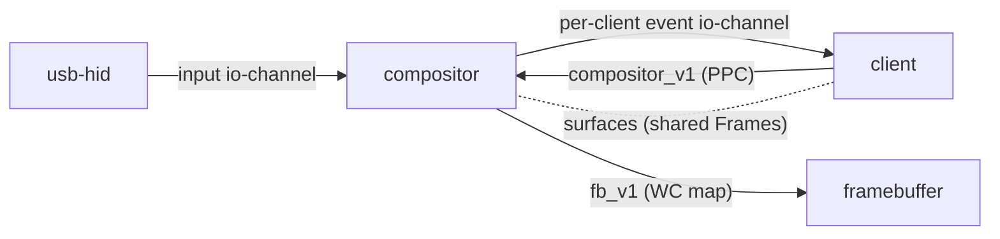

# UI compositor design

Status: the compositor owns the screen and the input and serves windows; the
implementation plan says what is still open. Q1 to Q12 are answered and recorded here;
`ui-compositor-completed.md` lists them, and no compositor decision is open.
Implementation order is in `ui-compositor-implementation-plan.md`.

## Scope

Only one component can hold the framebuffer: `fb_v1.frames lends (key_table)`
hands its Frames out once. The compositor holds it. `userspace/libs/framebuffer`
configures it through `fb_v1`, receives the Frames and maps them write-combining
in `FB_WINDOW_VA`. The shell draws in a window (its static scene on the first
Thread, the lava lamp on the second) and has no mapping of the framebuffer.

The compositor is the only holder of the framebuffer mapping.
Clients (the shell first, later any program) draw into surfaces they own and ask
the compositor to show them. The compositor also routes input to the window that
should receive it.

The input side is shared with `input-design.md`: the event record and channel
layout come from there, and the pointer and focus policy lives in the compositor.

## Prior art

- **ToaruOS Yutani** (`apps/yutani.c` and `base/usr/include/toaru/yutani-server.h`
  in klange/toaruos). The server keeps five z-lists (bottom, mid, menu, overlay,
  top) and one focused window. Each client window has its own shared buffer; the
  server reads it and never draws into it. `mark_window` and `mark_window_relative`
  queue damage rectangles. `redraw_windows` turns them into clip regions, blits
  the windows inside those clips in z-order, draws the cursor last, and flushes
  only the dirty areas to video memory. The mouse is a small state machine
  (normal, dragging, moving, resizing). A press focuses and raises the window
  under the cursor, and the drag and release events go to that window until the
  button comes up. Alt-drag moves a window and Alt-middle-drag resizes it. Resize
  is a negotiation: the server sends `RESIZE_OFFER`, the client allocates a new
  buffer, and the server swaps buffers. Keys go to the focused window after
  server-side key bindings. Decorations come from a client library.
  Take: damage queue, clipped z-ordered blit, dirty-only flush, press-owns-the-drag,
  negotiated resize. Avoid: hit-testing by reading client pixels (`check_top_at`),
  which needs the client's memory to stay readable to the compositor.
- **Wayland.** Clients allocate buffers and commit them with damage. Pointer enter
  and leave events come from the compositor, and a button press starts an implicit
  grab. Clients draw their own decorations, and the compositor runs interactive
  move and resize.
  Take: the commit-with-damage model and the implicit grab.
- **Plan 9 rio.** Each window has its own input and output stream, and the window
  system multiplexes them. Take: one event stream per client.
- **Fuchsia Flatland and Android SurfaceFlinger.** Buffer queues and scene graphs.
  Not needed at this size; noted for later layering work.

## Shape

- **Component `compositor`** (`userspace/gui/compositor`, a program like the shell,
  Q9). Imports `fb_v1` and the input channel. Exports a
  `local` interface `compositor_v1.if`. The framebuffer mapping code currently in
  `display.rs` (`map_framebuffer`) moves into a shared library that the compositor
  uses. Interfaces are prototypes and are edited in place.
- **Client to server: synchronous PPC.** Operations such as `connect`,
  `create_window`, `commit`, `move`, `resize`, `raise` and `destroy` are
  `compositor_v1` functions. The client Thread migrates into the compositor, so a
  commit needs no queue of its own. Compositor state is protected by one lock,
  because more than one compositor Thread may run.
- **Server to client: io-channel in receive mode.** `compositor_v1` declares
  `channel 1;`, so Kickstart gives each client one channel (Q3): a control page,
  a data page and an EventCount the compositor advances, as `input_v1` does for
  its client. The client posts empty IO_Recs, and the compositor fills one with
  the records a routed input frame sends to the client's windows and advances the
  client's EventCount. Records are the `input-event` record from
  `input-design.md`, with coordinates translated to window-local space and the
  window id in `subject`; each window's records end with a `Sync`. Window-level
  notifications (`Focus`, `Enter`, `Leave`, `ResizeOffer`, `CloseRequest`) are
  kinds of the same record. Overflow (Q11): a delivery that finds no buffer, or
  one too small, is dropped whole, the next one starts with `Dropped` (`subject`
  0), and the client resyncs with `compositor_v1.snapshot`, which writes the
  records that rebuild its focus, held keys and pointer. Deliveries happen under
  the compositor's turn, so each channel has one producer at a time: the input
  Thread after each frame, and `create_window` for the focus a new window takes.
  Both ends live in `userspace/libs/compositor-core` (`events`).
- **Surfaces.** Pixels are 32-bit, in the framebuffer's native order, which
  `fb_v1.pixel_order` reports. Surfaces are ARGB with premultiplied alpha, blended by the compositor. Surface pixels contain no
  pointers, so the compositor does not need the same virtual address in every
  AddressSpace. A surface is its bytes rounded up to a multiple of 2 MiB, made of 2 MiB
  Frames. The compositor carves them and installs a copy of each in the table the
  client lends to `create_window`; the client maps them where it likes in its
  surface window (`SURFACE_WINDOW_VA`), which Kickstart provisions in importers of
  `compositor_v1`, as it does the framebuffer window (`FB_WINDOW_VA`) for
  importers of `fb_v1`.
- **Compositing.** Software, on the single core, with fixed-capacity arrays and
  no allocation on the frame path. The back buffer is cacheable RAM. Damage is a
  bounded set of rectangles, merged into their bounding box when full. One frame:
  for each damage rectangle, clip and blit the windows bottom to top, draw the
  cursor sprite (its old and new rectangles are damage), then copy only dirty
  rectangles to the write-combining framebuffer. Layers in version 1 are
  background, normal windows, overlay (panel) and cursor. The compositor never reads
  the framebuffer back: it is write-combining, and hit-testing uses rectangles.
- **Redraw trigger (Q7).** A fixed 33 ms timer (`FRAME_NS` in
  `userspace/gui/compositor/src/frame.rs`) that runs only while damage exists. The
  answer asks for an adaptive target frame rate; the adaptation rule is deferred.
- **Input routing.** The compositor is the router. It clamps the pointer to the
  display, keeps button and modifier state through the `input-event` state
  tracker, and gives focus to a new window (Q12) and on click, raising the
  window. A press makes an implicit grab: motion and release go to that window
  until all buttons are up.
  Hover produces enter and leave events. Keyboard events go to the focused window
  as physical codes; modifier keys are ordinary `Key` records for the physical press and
  release, and the client tracks which modifiers are active. Keymaps and key repeat stay in the
  consumer, as `input-design.md` D6 proposes. Compositor chords (Alt-drag to move)
  are consumed before delivery. Hit-testing uses window rectangles. Pointer motion
  is coalesced into one event per client per `Sync` frame. Wood
  (`userspace/wood/vesper`) is the first client that reads the channel: it maps
  keyboard usages to Doom keys and releases held keys on losing the focus or on
  `Dropped`.
- **Decorations.** A client-side library. Version 1 has none; Alt-drag moves
  windows.
- **Shell.** `draw` creates a window. The lava thread draws into the surface and
  commits each frame. The shell's direct mapping of the framebuffer is removed.

## Constraints observed in the code

- `fb_v1.frames` hands out the framebuffer once. The compositor is the one client
  that receives it, so the shell has no direct path.
- Driver and program tables are 256 slots. A 1024x768 surface built only of 4 KiB
  Frames needs 768 slots, so surfaces are 2 MiB Frames (Q2).
- Kickstart wires imports by one of two `uses` forms (Q8): `uses mailbox_v1 via
  device firmware, mboxes { property }` follows a device-tree link (`via device
  compatible "..."` is the compatible-string form), and `uses fb_v1 via component fb`
  names a manifest component, whose one loaded instance exporting the interface is the
  exporter; none leaves the import not granted, and more than one is reported and not
  granted. A program has no device-tree node, so `via component` is how it can export.
- The USB HID component publishes keyboard and mouse events on `input_v1`'s
  io-channel and serves `descriptor` and `snapshot` calls. The compositor can be
  tested with injected events first.
- `fb_v1.frames` gives the framebuffer's memory away for good, and a second call
  fails: whatever holds the framebuffer holds it until reset.

## Hazards

Facts that shaped the answers above.

- **Revocation can reach the compositor's reads.** If a client owned surface memory
  the compositor reads and its authority were withdrawn, the next compositor read
  would fault, and the expected policy is Thread termination
  (`capabilities-contract.md`). The compositor owning the surface Frames (Q1) keeps a
  hostile client from taking it down this way. Selective Revoke is not enabled.
- **Table size.** A 1024x768 surface of 32-bit pixels is 3 MiB: 768 4 KiB Frames, or
  two 2 MiB Frames. Lent tables have 1024 slots in the shell and 256 in drivers, so
  surfaces of 4 KiB Frames would exhaust them quickly (Q2).
- **Write-combining is a ceiling, not a guarantee.** Surfaces in RAM are cacheable, so
  damaged rectangles reach the framebuffer through its write-combining mapping.
- **Reading client pixels.** Yutani hit-tests by reading each window's pixels, which
  couples input latency to client behaviour and needs client memory to stay readable.
  Hit-testing uses window rectangles, also with alpha (Q6).

## Future work

- **Separate `inputd`-style router.** A multiplexer between input producers and the
  compositor, as Redox `inputd` does, for when more than one consumer needs input. Not
  planned for version 1 (Q4).

## Related

- `doc/agentic/input-design.md` and `input-decisions.md`: event record, routing
  layer, open input decisions.
- `doc/agentic/usb-design.md`: producer side of input.
- `doc/agentic/capabilities-contract.md`: `CallWithKey` lending (the key
  travels in x8), Frame mapping, revocation and Thread termination.
- `libs/io-channel`, `libs/graphics`, `libs/device-driver`.
