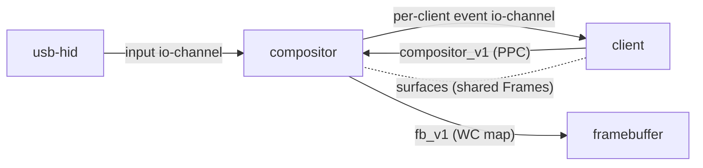

# UI compositor design

Status: design only, nothing implemented. Open decisions are listed in
`ui-compositor-decisions.md`. Implementation order is in
`ui-compositor-implementation-plan.md`.

## Scope

Today the shell owns the framebuffer. `userspace/shell/src/display.rs` configures
it through `fb_v1`, receives its Frames by `fb_v1.frames lends (key_table)` (handed
out once), maps them write-combining in `FB_WINDOW_VA`, and paints directly: the
static scene on the first Thread, the lava lamp on the second. Only one component
can hold the framebuffer, and every program that wants pixels would have to take
it over.

A compositor takes that role. It is the only holder of the framebuffer mapping.
Clients (the shell first, later any program) draw into surfaces they own and ask
the compositor to show them. The compositor also routes input to the window that
should receive it.

The input side is shared with `input-design.md`: the event record and channel
layout come from there, and the pointer and focus policy lives in the compositor.

## Prior art

- **ToaruOS Yutani** (`apps/yutani.c` and `base/usr/include/toaru/yutani-server.h`
  in klange/toaruos). The server keeps five z-lists (bottom, mid, menu, overlay,
  top) and one focused window. Each client window has its own shared buffer; the
  server reads it and never draws into it. `mark_window` and `mark_window_relative`
  queue damage rectangles. `redraw_windows` turns them into clip regions, blits
  the windows inside those clips in z-order, draws the cursor last, and flushes
  only the dirty areas to video memory. The mouse is a small state machine
  (normal, dragging, moving, resizing). A press focuses and raises the window
  under the cursor, and the drag and release events go to that window until the
  button comes up. Alt-drag moves a window and Alt-middle-drag resizes it. Resize
  is a negotiation: the server sends `RESIZE_OFFER`, the client allocates a new
  buffer, and the server swaps buffers. Keys go to the focused window after
  server-side key bindings. Decorations come from a client library.
  Take: damage queue, clipped z-ordered blit, dirty-only flush, press-owns-the-drag,
  negotiated resize. Avoid: hit-testing by reading client pixels (`check_top_at`),
  which needs the client's memory to stay readable to the compositor.
- **Wayland.** Clients allocate buffers and commit them with damage. Pointer enter
  and leave events come from the compositor, and a button press starts an implicit
  grab. Clients draw their own decorations, and the compositor runs interactive
  move and resize.
  Take: the commit-with-damage model and the implicit grab.
- **Plan 9 rio.** Each window has its own input and output stream, and the window
  system multiplexes them. Take: one event stream per client.
- **Fuchsia Flatland and Android SurfaceFlinger.** Buffer queues and scene graphs.
  Not needed at this size; noted for later layering work.

## Shape

- **Component `compositor`.** Imports `fb_v1` and the input channel. Exports a
  `local` interface `compositor_v1.if`. The framebuffer mapping code currently in
  `display.rs` (`map_framebuffer`) moves into a shared library that the compositor
  uses. Interfaces are prototypes and are edited in place.
- **Client to server: synchronous PPC.** Operations such as `connect`,
  `create_window`, `commit`, `move`, `resize`, `raise` and `destroy` are
  `compositor_v1` functions. The client Thread migrates into the compositor, so a
  commit needs no queue of its own. Compositor state is protected by one lock,
  because more than one compositor Thread may run.
- **Server to client: io-channel in receive mode.** The client posts empty IO_Recs,
  and the compositor fills them with whole event records and advances the client's
  EventCount. Records are the `input-event` record from `input-design.md`, with
  coordinates translated to window-local space and the window id in `subject`.
  Window-level notifications
  (`Focus`, `Enter`, `Leave`, `ResizeOffer`, `CloseRequest`) are kinds of the same
  record. Overflow follows the input design: drop, emit `Dropped`, and resync
  from state.
- **Surfaces.** Pixels are 32-bit, in the framebuffer's native order, which
  `fb_v1.pixel_order` reports. Surfaces are ARGB with premultiplied alpha, blended by the compositor. Surface pixels contain no
  pointers, so the compositor does not need the same virtual address in every
  AddressSpace. Each surface is mapped where its owner and the compositor find it
  convenient, and the client learns its address from the create reply. Kickstart
  must provision a surface window in importers of `compositor_v1`, as it already
  does for `fb_v1` importers through `FB_WINDOW_VA`.
- **Compositing.** Software, on the single core, with fixed-capacity arrays and
  no allocation on the frame path. The back buffer is cacheable RAM. Damage is a
  bounded set of rectangles, merged into their bounding box when full. One frame:
  for each damage rectangle, clip and blit the windows bottom to top, draw the
  cursor sprite (its old and new rectangles are damage), then copy only dirty
  rectangles to the write-combining framebuffer. Layers in version 1 are
  background, normal windows, overlay (panel) and cursor.
- **Input routing.** The compositor is the router. It clamps the pointer to the
  display, keeps button and modifier state through the `input-event` state
  tracker, and gives focus on click, raising the window. A press makes an
  implicit grab: motion and release go to that window until all buttons are up.
  Hover produces enter and leave events. Keyboard events go to the focused window
  as physical codes; modifier keys are ordinary `Key` records for the physical press and
  release, and the client tracks which modifiers are active. Keymaps and key repeat stay in the
  consumer, as `input-design.md` D6 proposes. Compositor chords (Alt-drag to move)
  are consumed before delivery. Hit-testing uses window rectangles. Pointer motion
  is coalesced into one event per client per `Sync` frame.
- **Decorations.** A client-side library. Version 1 has none; Alt-drag moves
  windows.
- **Shell.** `draw` creates a window. The lava thread draws into the surface and
  commits each frame. The shell's direct mapping of the framebuffer is removed.

## Constraints observed in the code

- `fb_v1.frames` hands out the framebuffer once. The compositor is the one client
  that receives it, so the shell's direct path goes away.
- Driver and program tables are 256 slots, but the shell's frame table is 1024
  slots (`FRAME_TABLE_BITS = 10`). A 1024x768 surface built only of 4 KiB Frames
  needs 768 slots, so surfaces need either larger tables or 2 MiB Frames.
- Kickstart wires imports through device-tree links (`uses X via ...`). A program
  has no node, so a program cannot yet export an interface. The shell is a program
  but only imports.
- `input_v1` today has only `set_leds`, and the USB HID component has no event
  source. The compositor can be tested with injected events first.

See `ui-compositor-decisions.md` for the open choices and the hazards.

## Related

- `doc/agentic/input-design.md` and `input-decisions.md`: event record, routing
  layer, input D9 (router).
- `doc/agentic/usb-design.md`: producer side of input.
- `doc/agentic/capabilities-contract.md`: `CallWithKey` lending (the key
  travels in x8), Frame mapping, revocation and Thread termination.
- `libs/io-channel`, `libs/graphics`, `libs/device-driver`.
