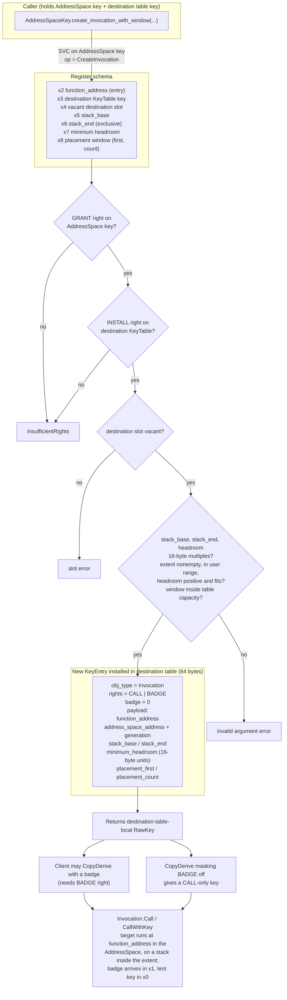

# AddressSpace

| | |
|---|---|
| Wire type | `0x82` (arch index 2) |
| Backing | Kernel record carved from an Untyped by [`Untyped.Retype`](../core/untyped.md#retype) |
| Operations | Activate, Retire, Bind, CreateInvocation |

## Purpose

An AddressSpace is a protection domain: a translation root, the ASID bound to it, and one KeyTable shared by every Thread running in it. Threads in different AddressSpaces cannot see each other's memory unless both map the same Frame. A Thread runs in one AddressSpace at a time and moves between them with [Invocation](../core/invocation.md) calls.

## Operations

| Op | Name | Arguments | Rights | Result |
|---|---|---|---|---|
| 0 | Activate | — | `Map` | — |
| 1 | Retire | — | `Retire` | — |
| 2 | Bind | `x2` KeyTable | `Map` on the AddressSpace, `Install` on the KeyTable | — |
| 3 | CreateInvocation | `x2` entry, `x3` destination table, `x4` destination slot, `x5` stack base, `x6` stack end, `x7` minimum headroom, `x8` key-placement window | `Grant` on the AddressSpace, `Install` on the destination | `x1` new Invocation key |

### Activate

Installs this AddressSpace's translation root and ASID into the hardware (`TTBR0_EL1`). Only the caller's own AddressSpace can be activated. It needs a root ([`PageTable.Map`](page_table.md#map)) and an ASID ([`ASIDPool.Assign`](asid_pool.md)) first. Activating an already active AddressSpace has no further effect.

| Error | Cause |
|---|---|
| `InsufficientRights` | The capability lacks `Map` |
| `NotBound` | No KeyTable is bound ([Bind](#bind)) |
| `NotMapped` | No root or no ASID |
| `InvalidOperation` | Not the caller's own AddressSpace, or the root or ASID does not fit the hardware configuration |
| `InvalidPointer` | The root address cannot be encoded |
| `InconsistentKey` | The AddressSpace was retired (`ObjectRetired`) |

The supported AArch64 configuration is a four-level, 48-bit translation with a 4 KiB granule. ASIDs are 1–255, or 1–65535 where the hardware supports 16-bit ASIDs.

### Retire

Destroys an AddressSpace other than the caller's. Its root must be unmapped first ([`PageTable.Unmap`](page_table.md#unmap) on the root). Retire flushes every TLB entry tagged with its ASID, returns the ASID to its pool and retires the AddressSpace: every capability to it then fails with `ObjectRetired`, and its memory is not reused. Threads still in it fail on their next invocation; retire them with [`Thread.Retire`](../core/thread.md#retire).

| Error | Cause |
|---|---|
| `InsufficientRights` | The capability lacks `Retire` |
| `InvalidOperation` | It is the caller's own AddressSpace, or its root is still installed |
| `InconsistentKey` | The AddressSpace was already retired (`ObjectRetired`) |

### Bind

Binds the KeyTable named by `x2` to this AddressSpace: Threads running in it resolve their keys through that table. [`Untyped.Retype`](../core/untyped.md#retype) creates an AddressSpace with no KeyTable, and Bind can be done once; the binding lasts for the AddressSpace's lifetime. Several AddressSpaces may share one KeyTable.

Before Bind, install a capability to the table itself in its slot 4 (`SELF_KEYTABLE`): the kernel reads the table's guard from it on every invocation. Bind installs the [return key](../core/thread.md#return) in slot 1 and nothing else, so the caller also installs the AddressSpace's own capability in slot 2 (`SELF_ADDRESS_SPACE`) if its Threads need one.

Until it is bound, an AddressSpace cannot be activated, cannot create Invocations and cannot receive Threads ([`Scheduler.ConfigureThread`](../core/scheduler.md#configurethread)); these fail with `NotBound`. Its translation can be set up before binding: [`PageTable.Map`](page_table.md#map), [`Frame.Map`](frame.md#map) and [`ASIDPool.Assign`](asid_pool.md) work on it.

| Error | Cause |
|---|---|
| `InsufficientRights` | The AddressSpace capability lacks `Map`, or the KeyTable capability lacks `Install` |
| `AlreadyMapped` | A KeyTable is already bound |
| `TypeMismatch` | `x2` is not a KeyTable capability |
| `InvalidSelfReference` | Slot 4 of the table does not hold a capability to the table itself (`x1` = 4, `x2` = the table key) |
| `InconsistentKey` | The AddressSpace was retired (`ObjectRetired`) |
| `SlotOccupied`, `InvalidOperation` | Slot 1 of the table holds another capability, or once held one |
| `InvalidOperation` | A nonzero `x3..x7` |

### CreateInvocation

Creates an [Invocation](../core/invocation.md) that calls `x2` in this AddressSpace on the stack extent `[x5, x6)` with minimum headroom `x7` bytes, and installs it into slot `x4` of the table named by `x3`. The new capability carries the `Call` and `Badge` rights: its holder can call it and [mint badged copies](../core/key_table.md#setting-a-badge), and a holder that does not need to mint copies it with `Badge` masked off. The entry address must be nonzero (`InvalidPointer`); the stack rules and errors are on the [Invocation](../core/invocation.md#stack-extent) page.

`x8` is the key-placement window that [`CallWithKey`](../core/invocation.md#callwithkey) uses: bits 31:0 are the first slot and bits 63:32 the number of slots, in this AddressSpace's own KeyTable. Zero means the Invocation accepts no lent key. A window that does not fit the table fails with `InvalidSlot`, naming its first slot. If the window is nonzero and the KeyTable does not hold a capability to itself in slot 4, CreateInvocation fails with `InvalidSelfReference` (`x1` = 4, `x2` = the AddressSpace key). The slots need not be vacant when the Invocation is created.

An AddressSpace with no KeyTable bound fails with `NotBound`. Failures leave the destination table unchanged.

## Implementation

`Untyped.Retype` creates AddressSpaces (`size_bits` 0) from an Untyped's memory; the boot AddressSpace is created and bound by the boot code. An AddressSpace's translation-table leaves are tagged with its ASID, so switching AddressSpaces needs no TLB flush. The AddressSpace also records whether its fault handler is busy and how many faults went unhandled; see [fault delivery](../core/thread.md#fault-delivery). Retire does not free the KeyTable's memory.
