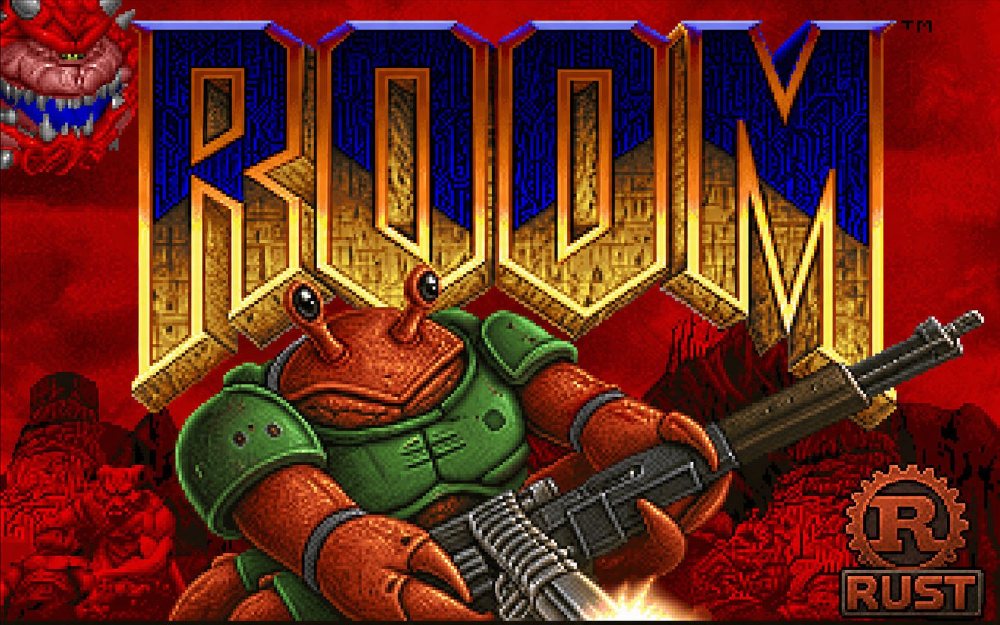

# room

<div align="center">
  
</div>

A complete Rust port of [doomgeneric](https://github.com/ozkl/doomgeneric) using
[winit](https://github.com/rust-windowing/winit) and [wgpu](https://github.com/gfx-rs/wgpu)
for the platform layer.

## What is this?

`room` is a **complete Rust port** of the classic DOOM engine based on
[doomgeneric](https://github.com/ozkl/doomgeneric). Every engine module has
been rewritten in native Rust; no C engine code remains linked. However, it is not
idiomatic Rust yet, and contributions are welcome.

The port was done **module-by-module**:

1. Each module was rewritten in Rust inside `room/src/engine/` and exported
   with `#[no_mangle] extern "C"` so the linker picked the Rust symbol
   instead of the C one.
2. Once replaced, the corresponding `.c` file was removed from
   `doomgeneric-sys/build.rs`.
3. The platform layer (window creation, GPU rendering, keyboard input) is
   pure Rust, built on [winit](https://github.com/rust-windowing/winit)
   and [wgpu](https://github.com/gfx-rs/wgpu).

The engine library is `no_std` + `alloc`: it reaches the OS only through the
`Platform` trait (`src/engine/platform.rs`: frames, input, time, sound,
files, quit, the error dialog) and logs through the `log` crate, so it also
builds for bare-metal targets such as Vesper.

The `lib_sources` list in `doomgeneric-sys/build.rs` is now empty — all engine
subsystems (`r_draw`, `p_setup`, `z_zone`, `g_game`, `d_main`, and every other
module) are native Rust.

A regression-test suite (`room/tests/c_tests/`) pins the constants, tables
and behaviour of the original C modules, so a change to the port that drifts
from the C engine fails there.

Sound effects and music are implemented via [rodio](https://github.com/RustAudio/rodio). SFX uses stereo panning; music uses the [Roland SC-55 SoundFont](https://github.com/GuihongWang/SC55Soundfont) via [rustysynth](https://github.com/sinshu/rustysynth). A custom soundfont can be specified with `-sf2 <path>`.

## Project layout

```
room/
├── Cargo.toml               Crate manifest
├── doom.md                  C source prefix → engine module mapping
├── tests/
│   ├── c_tests/             Regression tests pinning the C modules' behaviour
│   └── demo_playthrough.rs  Plays the demos headless against a frame baseline
└── src/
    ├── main.rs              Entry point: runs the selected platform
    ├── lib.rs               The engine library
    ├── platform/
    │   ├── mod.rs           Platform selection
    │   ├── std.txt          Why the engine needs no std (it is no_std + alloc)
    │   ├── host/            winit + wgpu + rodio
    │   │   ├── mod.rs       The `Platform` impl: video, input, timer, audio calls
    │   │   ├── system.rs    Files, exit and the Zenity error dialog
    │   │   ├── app.rs       winit ApplicationHandler, run()
    │   │   ├── gpu.rs       wgpu renderer (texture upload + fullscreen blit)
    │   │   ├── keys.rs      winit KeyCode → Doom key byte mapping
    │   │   └── audio/       Sound and music on rodio + rustysynth
    │   └── vesper/          Placeholder `Platform` impl for the Vesper component
    └── engine/              Ported engine, one module per C file (see doom.md)
        ├── mod.rs           Module list
        ├── platform.rs      doomgeneric: the `Platform` trait and engine entry point
        ├── map.rs           r_defs: map geometry types shared by play and renderer
        ├── doom/            d_*: main loop, events, game state, startup
        ├── game.rs          g_game: game control, save/load, level changes
        ├── play/            p_*: world simulation
        ├── render_3d/       r_*: 3D renderer
        ├── render_2d.rs     v_video: 2D drawing
        ├── interface/       i_*: platform-facing services
        ├── wad/             w_*: WAD access
        ├── zone.rs          z_zone: zone memory allocator
        ├── misc/            m_*: menus, config, utilities
        ├── math/            m_fixed, m_bbox, tables: fixed-point math
        ├── hud/, status/    hu_*, st_*: HUD and status bar
        ├── automap.rs, intermission/, finale/, sound/
        ├── dehacked.rs      deh_str: DeHackEd string hook
        └── memio.rs         Not placed yet
```

## Prerequisites

- A Rust toolchain (stable, ≥ 1.75).
- A C compiler (`gcc` or `clang`).
- A Doom WAD file (`doom1.wad`, `doom.wad`, `doom2.wad`, `freedoom1.wad`, …).
  The shareware episode is freely available from many sources.

## Building

```bash
cargo build --release
```

## Running

```bash
cargo run --release -- -iwad /path/to/doom1.wad
```

Any arguments after `--` are forwarded to the Doom engine unchanged.

## How it works

The engine runs inside the winit event loop:

1. `ApplicationHandler::resumed` creates the window and initialises the wgpu
   renderer, storing both in thread-local statics accessible to the `DG_*`
   callbacks.
2. `ApplicationHandler::about_to_wait` calls `doomgeneric_Create` on the first
   invocation (which initialises all Doom subsystems and runs the first tick),
   then `doomgeneric_Tick` on every subsequent invocation.
3. `DG_DrawFrame` (called from inside `doomgeneric_Tick`) uploads the 640 × 400
   BGRA pixel buffer produced by `I_FinishUpdate` to a wgpu texture and blits
   it to the swapchain surface via a fullscreen-quad render pass.
4. Keyboard events collected by `ApplicationHandler::window_event` are placed
   into a `VecDeque`; `DG_GetKey` pops them one at a time per tick.

## Known limitations

- **No mouse support.**  Mouse aiming / strafing are not yet implemented.
- **No joystick support.**
- **Single player only.**  Networking (`FEATURE_MULTIPLAYER`) is not compiled in.
- The renderer performs a nearest-neighbour upscale from the native 640 × 400
  resolution to the window size; the window is currently fixed at 640 × 400.

## Ported modules

All vendored `.c` modules have been removed from `doomgeneric-sys/build.rs` and
fully replaced by Rust code in the `room` crate. Port complete.

### Engine core / game loop

- [x] `d_event.c`
- [x] `d_items.c`
- [x] `d_iwad.c`
- [x] `d_loop.c`
- [x] `d_main.c`
- [x] `d_mode.c`
- [x] `d_net.c`
- [x] `doomdef.c`
- [x] `doomstat.c`
- [x] `dstrings.c`
- [x] `dummy.c`
- [x] `doomgeneric.c`

### Game logic (`g_*`, `p_*`)

- [x] `g_game.c`
- [x] `p_ceilng.c`
- [x] `p_doors.c`
- [x] `p_enemy.c`
- [x] `p_floor.c`
- [x] `p_inter.c`
- [x] `p_lights.c`
- [x] `p_map.c`
- [x] `p_maputl.c`
- [x] `p_mobj.c`
- [x] `p_plats.c`
- [x] `p_pspr.c`
- [x] `p_saveg.c`
- [x] `p_setup.c`
- [x] `p_sight.c`
- [x] `p_spec.c`
- [x] `p_switch.c`
- [x] `p_telept.c`
- [x] `p_tick.c`
- [x] `p_user.c`

### Renderer (`r_*`)

- [x] `r_bsp.c`
- [x] `r_data.c`
- [x] `r_draw.c`
- [x] `r_main.c`
- [x] `r_plane.c`
- [x] `r_segs.c`
- [x] `r_sky.c`
- [x] `r_things.c`

### Automap / HUD / status bar / finale / intermission

- [x] `am_map.c`
- [x] `hu_lib.c`
- [x] `hu_stuff.c`
- [x] `st_lib.c`
- [x] `st_stuff.c`
- [x] `f_finale.c`
- [x] `f_wipe.c`
- [x] `wi_stuff.c`
- [x] `statdump.c`

### Menu / misc / math

- [x] `m_argv.c`
- [x] `m_bbox.c`
- [x] `m_cheat.c`
- [x] `m_config.c`
- [x] `m_controls.c`
- [x] `m_fixed.c`
- [x] `m_menu.c`
- [x] `m_misc.c`
- [x] `m_random.c`
- [x] `tables.c`
- [x] `info.c`

### Platform / system (doomgeneric side, not the Rust host)

- [x] `i_cdmus.c`
- [x] `i_endoom.c`
- [x] `i_input.c`
- [x] `i_joystick.c`
- [x] `i_scale.c`
- [x] `i_sound.c`
- [x] `i_system.c`
- [x] `i_timer.c`
- [x] `i_video.c`

### Sound effects and music subsystem

- [x] `s_sound.c` - sound and music state machine fully ported
- [x] `sounds.c` - SFX and music tables fully ported
- [x] `i_sound.c` - SFX playback via rodio (stereo pan); music via rustysynth + SC-55 soundfont

### Video / WAD / memory / utilities

- [x] `v_video.c`
- [x] `w_checksum.c`
- [x] `w_file.c`
- [x] `w_file_stdc.c`
- [x] `w_main.c`
- [x] `w_wad.c`
- [x] `memio.c`
- [x] `sha1.c`
- [x] `z_zone.c`

## License

This repository includes the unmodified Doom shareware IWAD, `doom1.wad`,
copyright id Software. It is included under the Doom shareware distribution
terms. The full registered/commercial Doom IWADs are not included and are
not redistributable.
