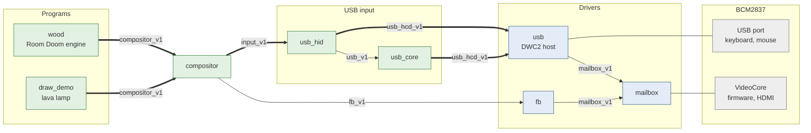
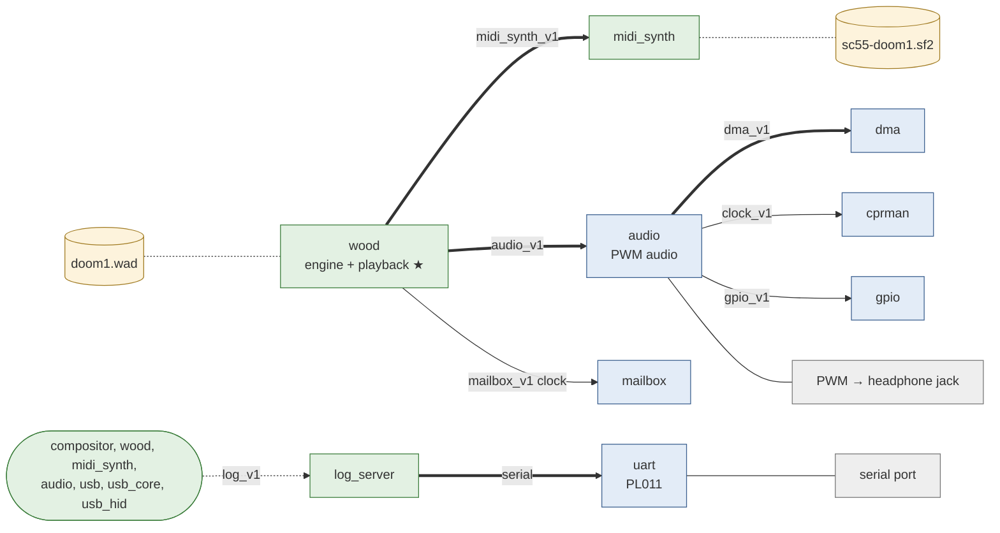
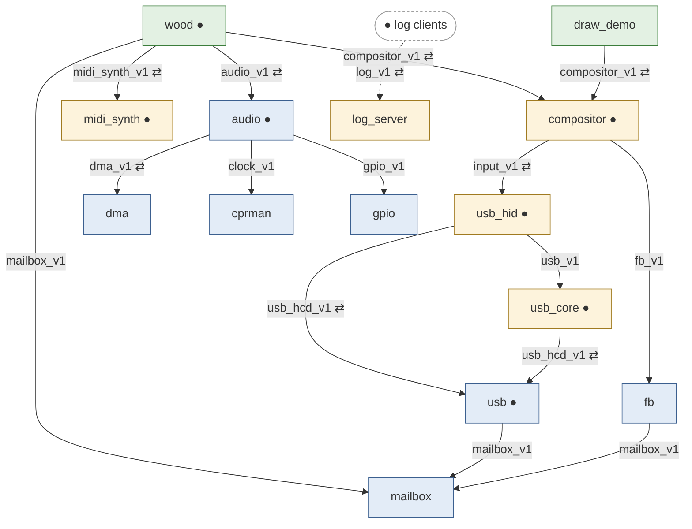

# The wood-test hardware image

What `just build-wood-test-hw` bundles (`kernel/tests/wood-test/image.toml`) and how
the parts are wired, in three diagrams sized for one slide each: the display and
input path, the sound and log path, and the interfaces between all components.
Arrows go from the importer to the exporter and are labelled with the interface
(`imports.if`):

- thick arrows (and ⇄ on slide 3): an interface with an io-channel (Kickstart gives
  the importer a control page, data pages and an EventCount);
- thin arrows: calls only;
- dotted lines: a log line channel (`log_v1`) or a bundled resource.

Kickstart loads everything and makes the connections at boot; the root dispatcher
then runs every program's Threads, high-priority ones first (only Wood's playback
Thread is high).

## Slide 1: display and input

- Wood and the lamp each own a window: frames go into the window's surface, and
  `commit` tells the compositor what changed. The compositor composes on its own
  33 ms timer into the framebuffer `fb` set up through the firmware.
- `usb_hid` turns keyboard and mouse reports into input events. The compositor
  routes them to the focused window and sends focus changes on the window's
  event channel. Wood's window takes the focus when it opens; the lamp stops
  animating while unfocused.

## Slide 2: sound, music and logs

- ★ Wood's playback Thread runs at high priority. Each 11.6 ms period it sends the
  queued MIDI commands to `midi_synth`, pulls one rendered period (the synthesiser
  renders inside the `service` call), mixes the sound effects on top and queues
  the result on `audio_v1`, keeping 8 buffers (93 ms) ahead of the driver.
- The audio driver converts the frames to PWM words in a 4-period DMA ring; `dma`
  alone holds the DMA controller, `cprman` sets the PWM clock to 100 MHz and
  `gpio` routes pins 40 and 41 to the jack. It loads only when `config.txt` has
  `dtoverlay=pwm-2chan,pin=40,func=4,pin2=41,func2=4`; without it Wood runs silent.
- `log_server` is the only holder of the serial port. Its clients never wait: a
  line that finds no free buffer is dropped and counted, and the next line shows
  `(N dropped)`.

## Slide 3: interfaces

Which component depends on which, through which Meddle interface (`.if`): each arrow
goes from the importer to the exporter. ⇄ marks an interface with an io-channel, ●
a `log_v1` client of `log_server` (drawn once, so the log edges do not cross the
rest). Applications are green, services amber, drivers blue.

`pipe_v1` is not drawn: nobody imports it. `usb_hcd_v1.open_pipe` installs its keys
in the caller's table. `usb_core` opens pipes for enumeration; `usb_hid` gets its
interrupt pipe's parameters from `usb_v1.interrupt_pipe` and opens the pipe itself,
so the reports travel on its own channel.

| Interface | File | Exporter | Importers in wood-test |
|---|---|---|---|
| `compositor_v1` ⇄ | `userspace/gui/compositor/interfaces/` | compositor | wood, draw_demo |
| `midi_synth_v1` ⇄ | `userspace/wood/midi-synth/interfaces/` | midi_synth | wood |
| `audio_v1` ⇄ | `drivers/audio-pwm-bcm2835/interfaces/` | audio | wood |
| `log_v1` ⇄ | `userspace/log-server/interfaces/` | log_server | wood, compositor, midi_synth, audio, usb, usb_core, usb_hid |
| `input_v1` ⇄ | `drivers/usb-hid/interfaces/` | usb_hid | compositor |
| `usb_v1` | `drivers/usb/interfaces/` | usb_core | usb_hid |
| `usb_hcd_v1` ⇄ | `drivers/usb-hcd-dwc2/interfaces/` | usb | usb_core, usb_hid |
| `pipe_v1` | `drivers/usb-hcd-dwc2/interfaces/` | usb | keys from `open_pipe` |
| `fb_v1` | `drivers/fb/interfaces/` | fb | compositor |
| `dma_v1` ⇄ | `drivers/dma-bcm2835/interfaces/` | dma | audio |
| `clock_v1` | `drivers/cprman-bcm2835/interfaces/` | cprman | audio |
| `gpio_v1` | `drivers/gpio-bcm2835/interfaces/` | gpio | audio |
| `mailbox_v1` | `drivers/mailbox/interfaces/` | mailbox | wood, fb, usb |

The serial port is not an interface: Kickstart attaches `log_server` (`serial = true`)
to the PL011 driver's serial channel directly.
