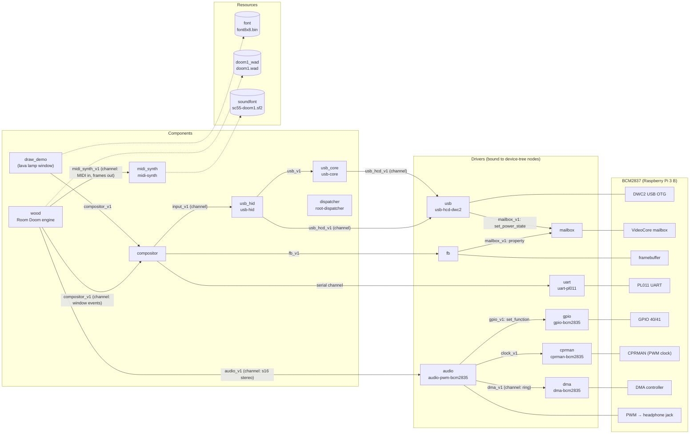

# The wood-test hardware image

What `just build-wood-test-hw` bundles (`kernel/tests/wood-test/image.toml`) and
how the parts are wired. An arrow goes from the importer to the exporter and is
labelled with the interface (`imports.if`). An interface marked *channel* also
carries an io-channel: Kickstart gives the importer a control page, data pages and
an EventCount. Kickstart loads everything and makes the connections at boot. The
root dispatcher then runs every program's Threads.

The hardware image is built without `qemu`, so:

- the audio driver streams through a circular DMA ring;
- Wood's log is dropped;
- the compositor traces routed input on the UART.

The audio driver loads only when `config.txt` has
`dtoverlay=pwm-2chan,pin=40,func=4,pin2=41,func2=4`. Without it Wood runs silent.

## Notes

- **Wood's threads.** The engine Thread draws frames and reads keys from the
  compositor. Its `music_*` and `sound_*` methods only queue work. Each period,
  Wood's playback Thread:
  1. sends the queued MIDI commands to `midi_synth`;
  2. pulls one rendered period, which `midi_synth` renders inside the `service`
     call;
  3. mixes the sound effects on top;
  4. queues the result on `audio_v1`.
- **The audio path.**
  - The audio driver converts the s16 frames to PWM words in its DMA ring.
  - `dma` alone holds the DMA controller's page.
  - `cprman` sets PWM clock 30 to 100 MHz (PLLD/5).
- **Input.** `usb_hid` reads reports over interrupt pipes. The compositor
  routes them to the focused window, Wood's or the lava lamp's.
- **The dispatcher** is bound last. It schedules the Threads of every component
  above.
